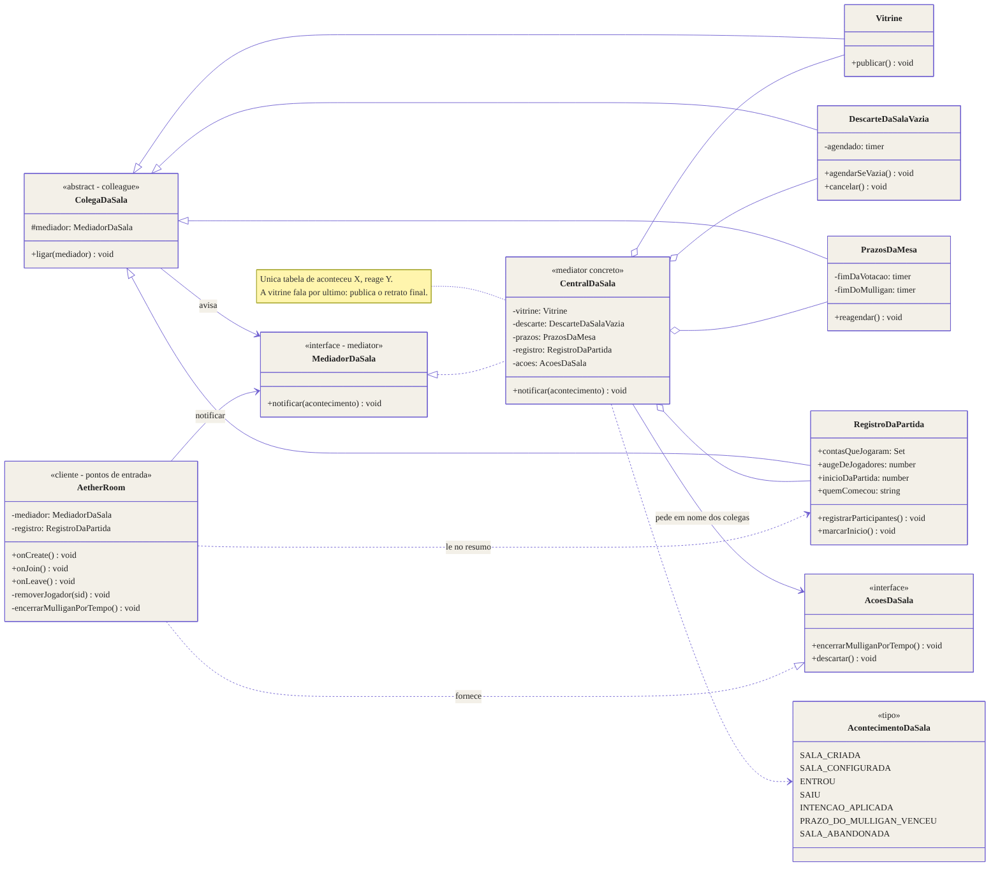
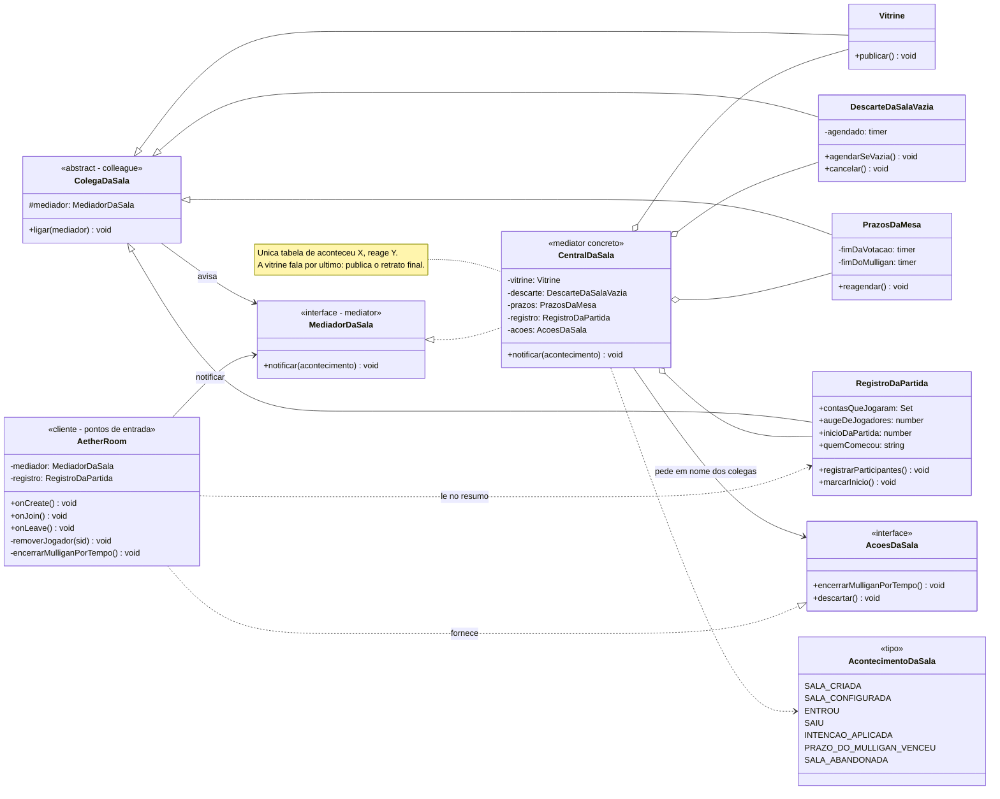

# Padrão: Mediator

| Campo                   | Valor                                                                                                                       |
| ----------------------- | --------------------------------------------------------------------------------------------------------------------------- |
| **ID**                  | `DOC-100`                                                                                                                   |
| **Status**              | Ativo                                                                                                                       |
| **Vale para**           | `apps/game-server`                                                                                                          |
| **Código**              | `src/rooms/mediador-da-sala.ts`, `src/rooms/AetherRoom.ts`                                                                  |
| **Documentos vizinhos** | [`DOC-097`](padroes_command_e_template_method.md), [`DOC-098`](padrao_memento.md), [`DOC-021`](documento_de_arquitetura.md) |

---

## 1. O que este documento cobre

| Padrão       | Onde                            | Problema que resolve                                                                              |
| ------------ | ------------------------------- | ------------------------------------------------------------------------------------------------- |
| **Mediator** | o ciclo de vida da `AetherRoom` | oito pontos de entrada, cada um com a sua lista de quem avisar, que precisavam concordar sozinhas |

O Command (`DOC-097`) organiza **o que** uma intenção faz; o Mediator organiza
**quem mais precisa saber** depois que algo aconteceu na sala.

Quase nada muda para quem joga. A exceção é um defeito que o padrão fecha
(§6): a mesa encerrada continuava listada como "em partida".

---

## 2. O problema, em concreto

Quatro partes da sala reagem quando a mesa muda:

| Parte                        | O que faz                                                             |
| ---------------------------- | --------------------------------------------------------------------- |
| a **vitrine** pública        | publica o metadado que `GET /salas` lê (ocupação, "em partida"...)    |
| o **descarte** da sala vazia | agenda o fim da sala que ficou sem ninguém, e cancela se alguém volta |
| os **prazos**                | fecham a votação de remoção e a janela de mulligan no relógio da sala |
| o **registro** da partida    | quem jogou, o auge de jogadores, quando começou e quem começou        |

E oito lugares da `AetherRoom` disparavam essas reações, cada um à mão, com a
sua própria lista:

| Ponto de entrada       | Chamava                                          |
| ---------------------- | ------------------------------------------------ |
| `onCreate`             | descarte                                         |
| `aplicarConfig`        | vitrine                                          |
| entrar como jogador    | descarte, registro (se em partida), vitrine      |
| entrar como espectador | descarte, vitrine                                |
| saída do espectador    | vitrine, descarte                                |
| `removerJogador`       | vitrine (no meio), descarte (no fim)             |
| despacho de intenção   | prazos, e — se a fase mudou — vitrine e registro |
| mudança de lotação     | vitrine                                          |

Nada ligava essas listas. Esquecer uma linha não quebra teste nenhum: a sala
continua funcionando e só a lista pública mente. O código já tinha as marcas
disso — o comentário "a ocupação mudou: sem isto a lista pública mostraria 1/4"
existe porque a linha faltou uma vez.

---

## 3. O desenho

Fonte do diagrama: [`diagramas/mediator.mmd`](diagramas/mediator.mmd).

---

## 4. Os papéis do padrão

| Papel GoF           | Neste código                                                                                     |
| ------------------- | ------------------------------------------------------------------------------------------------ |
| `Mediator`          | `MediadorDaSala` — uma operação só: `notificar(acontecimento)`                                   |
| `ConcreteMediator`  | `CentralDaSala` — a tabela de "aconteceu X, reage Y", num `switch` só                            |
| `Colleague`         | `ColegaDaSala` — classe base; conhece só o mediador (`ligar`)                                    |
| `ConcreteColleague` | `Vitrine`, `DescarteDaSalaVazia`, `PrazosDaMesa`, `RegistroDaPartida`                            |
| quem dispara        | a `AetherRoom`, nos pontos de entrada — ela só conta **o que** aconteceu (`AcontecimentoDaSala`) |

O fluxo, num exemplo:

1. Um jogador sai de vez. `removerJogador` faz o trabalho dele (cartas, assentos,
   vez, vencedor) e, no fim, uma linha: `mediador.notificar({ tipo: 'SAIU' })`.
2. A `CentralDaSala` decide: a **vitrine** publica a ocupação nova; o
   **descarte** agenda o fim da sala se ela ficou vazia.
3. Trinta segundos depois, o timer do descarte vence. O colega **não** chama a
   Room: ele avisa a central (`SALA_ABANDONADA`), e a central pede à Room que se
   descarte (`AcoesDaSala.descartar`).

### Os colegas também falam

Dois colegas têm algo a dizer por conta própria, e os dois falam com a central:

| Colega                | Quando                        | Avisa                      | A central…                      |
| --------------------- | ----------------------------- | -------------------------- | ------------------------------- |
| `PrazosDaMesa`        | o prazo do mulligan venceu    | `PRAZO_DO_MULLIGAN_VENCEU` | pede `encerrarMulliganPorTempo` |
| `DescarteDaSalaVazia` | a espera da sala vazia acabou | `SALA_ABANDONADA`          | pede `descartar`                |

`AcoesDaSala` é a porta estreita para o que só a Room sabe fazer: encerrar o
mulligan move cartas pelo REGISTRY com o contexto de cada jogador, e descartar é
`disconnect()`. Um colega que recebesse a Room inteira para isso voltaria a ser
o acoplamento que o padrão tira.

---

## 5. A tabela da central

| Acontecimento              | Quem conta                   | Reação, nesta ordem                                                                          |
| -------------------------- | ---------------------------- | -------------------------------------------------------------------------------------------- |
| `SALA_CRIADA`              | `onCreate`                   | descarte agenda (cobre a sala que ninguém ocupa)                                             |
| `SALA_CONFIGURADA`         | `aplicarConfig`, lotação     | vitrine publica                                                                              |
| `ENTROU`                   | jogador ou espectador        | descarte cancela → registro anota (se em partida) → vitrine publica                          |
| `SAIU`                     | espectador, `removerJogador` | vitrine publica → descarte agenda (se vazia)                                                 |
| `INTENCAO_APLICADA`        | despacho                     | prazos reagendam → se a fase mudou: registro marca o início (se `PLAYING`) → vitrine publica |
| `PRAZO_DO_MULLIGAN_VENCEU` | `PrazosDaMesa`               | Room encerra o mulligan                                                                      |
| `SALA_ABANDONADA`          | `DescarteDaSalaVazia`        | Room se descarta                                                                             |

**A vitrine fala por último** porque ela publica o retrato da sala, e o retrato
só está certo depois que todo o resto reagiu. Essa regra agora mora num lugar
só; antes ela dependia de cada ponto de entrada pôr a chamada no lugar certo.

---

## 6. O defeito que o padrão fecha

`removerJogador` publicava a vitrine **no meio** — antes de verificar se o
último que ficou tinha vencido. Num 1v1, o oponente fechar a aba encerrava a
partida (`CLOSING`), mas a lista pública já tinha sido publicada com
`emPartida: true` e assim ficava: o dashboard mostrava "em partida" numa mesa
que já tinha acabado.

Com a central, `removerJogador` avisa `SAIU` no fim, e a vitrine publica o
estado final. O teste `ciclo-da-sala.spec.ts` › "a vitrine pública" falha sem a
mudança (foi rodado contra o código antigo antes do refactor).

---

## 7. O que ficou na Room, e por quê

- **A foto de cada jogador e o envio do resumo pós-partida.** Eles leem o
  `RegistroDaPartida`, mas dependem de coisas que só a Room tem (o deck de cada
  sessão, o vencedor, o `fetch` com o token interno).
- **`encerrarMulliganPorTempo`.** Passa pelo REGISTRY; a central o pede por
  `AcoesDaSala`.
- **O topo revelado** (`aplicarTopoRevelado`). Ele é parte da intenção, não uma
  reação a ela: roda para o remetente, com o contexto dele.

---

## 8. Testes

| Arquivo                          | O que cobre                                                                                                                            |
| -------------------------------- | -------------------------------------------------------------------------------------------------------------------------------------- |
| `rooms/mediador-da-sala.spec.ts` | a central sozinha: cada acontecimento chega aos colegas certos; colegas avisam a central; vitrine privada; votação e mulligan vencidos |
| `rooms/ciclo-da-sala.spec.ts`    | a sala de verdade: o caso da vitrine "em partida" (§6), mais os testes de votação, mulligan e resumo, agora passando pela central      |
