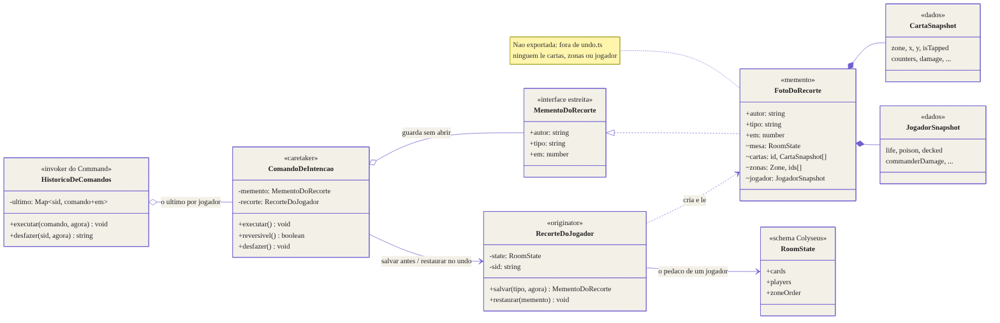
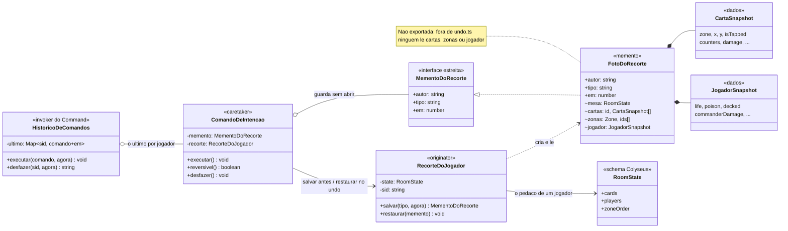

# Padrão: Memento

| Campo                   | Valor                                                                                                                                                     |
| ----------------------- | --------------------------------------------------------------------------------------------------------------------------------------------------------- |
| **ID**                  | `DOC-098`                                                                                                                                                 |
| **Status**              | Ativo                                                                                                                                                     |
| **Vale para**           | `apps/game-server`                                                                                                                                        |
| **Código**              | `src/services/undo.ts`, `src/intents/comandos.ts`                                                                                                         |
| **Documentos vizinhos** | [`DOC-097`](padroes_command_e_template_method.md), [`DOC-032`](especificacao_do_motor_sandbox.md) §3.2, [`DOC-031`](especificacao_websocket_e_eventos.md) |

---

## 1. O que este documento cobre

| Padrão      | Onde                     | Problema que resolve                                                                                  |
| ----------- | ------------------------ | ----------------------------------------------------------------------------------------------------- |
| **Memento** | desfazer (`INTENT_UNDO`) | a foto do estado anterior era um objeto aberto, que qualquer um lia e que se aplicava a qualquer mesa |

O Memento é o par do Command do [`DOC-097`](padroes_command_e_template_method.md):
o Command decide **quando** fotografar e quando desfazer; o Memento decide **o
que** entra na foto e **quem** pode abri-la.

Não muda o comportamento visível da mesa. A correção que veio junto (§7) muda,
e por isso tem commit próprio.

---

## 2. O problema, em concreto

O memento já existia — o `DOC-097` já chamava `Snapshot` de "memento" — mas sem
o padrão. Era isto:

```ts
export interface Snapshot {
  sid: string;
  tipo: string;
  em: number;
  cartas: [string, CartaSnapshot][];
  zonas: [Zone, string[]][];
  jogador: JogadorSnapshot | null;
}

export function capturar(state: RoomState, sid: string, tipo: string): Snapshot;
export function restaurar(state: RoomState, snap: Snapshot): void;
```

1. **A foto era um objeto aberto.** Ela carrega a ordem do grimório e da mão do
   jogador — informação oculta. Qualquer código que segurasse o `Snapshot` (o
   comando, um log de depuração, um teste) podia ler `cartas` e `zonas`, ou
   alterá-las antes da restauração.
2. **`restaurar` aplicava qualquer coisa com o formato certo.** Um literal
   montado à mão passava. A foto de **outra mesa** também: ela seria reaplicada
   por id numa sala onde esses ids significam outras cartas.
3. **O recorte estava escrito duas vezes**, uma em cada função solta, e as duas
   precisavam concordar sobre os mesmos 37 campos sem nada que as ligasse.

---

## 3. O desenho



Fonte do diagrama: [`diagramas/memento.mmd`](diagramas/memento.mmd).



---

## 4. Os papéis do padrão

| Papel GoF                      | Neste código                                                                   |
| ------------------------------ | ------------------------------------------------------------------------------ |
| `Originator`                   | `RecorteDoJogador` — o pedaço da mesa que é de um jogador                      |
| `Memento` (interface estreita) | `MementoDoRecorte` — `autor`, `tipo` e `em`; é o que o caretaker enxerga       |
| `Memento` (interface larga)    | `FotoDoRecorte` — o conteúdo; a classe não é exportada                         |
| `Caretaker`                    | `ComandoDeIntencao` — guarda a foto sem abri-la                                |
| `createMemento()`              | `RecorteDoJogador.salvar(tipo)`                                                |
| `setMemento(m)`                | `RecorteDoJogador.restaurar(memento)`                                          |
| estado do originador           | o recorte do `RoomState`: cartas do jogador, listas das zonas dele, o `Player` |

O fluxo, de ponta a ponta:

1. A `AetherRoom` monta um `ComandoDeIntencao` e entrega ao `HistoricoDeComandos`.
2. `ComandoDeIntencao.executar()` pede `recorte.salvar(tipo)` **antes** de o
   handler mutar a mesa (é a garantia do Command, `DOC-097` §2.3) e guarda o
   `MementoDoRecorte` que volta.
3. No `INTENT_UNDO`, o histórico chama `comando.desfazer()`, que devolve a foto
   ao **mesmo** originador: `recorte.restaurar(memento)`.

O comando nunca lê o que está dentro da foto. Ele só a carrega de um passo ao
outro — que é exatamente o contrato de caretaker.

---

## 5. Interface estreita e interface larga, em TypeScript

O GoF pede que o caretaker veja uma interface estreita e só o originador veja a
larga. Em C++ isso é `friend`; aqui é o **escopo de módulo**:

```ts
// exportada: é o tipo que o caretaker conhece
export interface MementoDoRecorte {
  readonly autor: string;
  readonly tipo: string;
  readonly em: number;
}

// NÃO exportada: fora de undo.ts ninguém consegue nomear o tipo
class FotoDoRecorte implements MementoDoRecorte {
  /* autor, tipo, em, mesa, cartas, zonas, jogador */
}

export class RecorteDoJogador {
  salvar(tipo: string, agora = Date.now()): MementoDoRecorte {
    /* ... */
  }
  restaurar(memento: MementoDoRecorte): void {
    if (
      !(memento instanceof FotoDoRecorte) ||
      memento.mesa !== this.state ||
      memento.autor !== this.sid
    )
      throw new Error('... não é deste recorte ...');
    /* ... */
  }
}
```

- `memento.cartas` fora de `undo.ts` **não compila** — o teste fixa isso com um
  `@ts-expect-error`.
- O `instanceof` é o que transforma "tem o formato certo" em "foi este módulo
  que criou". Um literal forjado é recusado.
- `mesa` e `autor` fecham o item 2 de §2: a foto só volta para a mesa e para o
  jogador de onde saiu.

**Por que lançar, e não ignorar.** O único caretaker monta o originador com a
própria mesa e o próprio autor; uma foto alheia chegando ali é defeito de quem
chamou. Ignorar em silêncio produziria um "desfazer" que anuncia "desfeito" sem
mudar nada — o mesmo no-op mudo que o Command veio fechar.

**Por que o originador não é o próprio `RoomState`.** O `RoomState` é um schema
do Colyseus, que serializa por índice e é espelhado no cliente
(`pnpm schema:sync`). Pôr `salvar`/`restaurar` dentro dele misturaria o padrão
com o contrato de rede. O `RecorteDoJogador` é uma janela sobre a parte da mesa
que pertence a um jogador — e é ela, não a mesa inteira, que define o recorte.

---

## 6. O que a foto guarda, e o que não

O recorte não mudou: as cartas de que o jogador é **dono ou controlador**, as
listas de ordem das zonas **dele** e os marcadores do **próprio** `Player`.
Restaurar mais que isso deixaria de ser "desfazer" e viraria "reescrever a mesa".

O que não volta atrás — aleatoriedade, olhadas, revelações, estado da mesa —
continua em `NAO_REVERSIVEIS`, em `services/undo.ts`, com a razão de cada
entrada. A decisão de **não** tirar foto é do comando
(`ComandoDeIntencao.reversivel()`), não do memento.

---

## 7. Uma correção que o teste do memento encontrou

O primeiro teste do originador isolado — "salvar, esvaziar uma zona, restaurar"
— lançou:

```
ArraySchema#splice(): insertCount must be equal or lower than deleteCount.
```

As listas de zona são `ArraySchema`, e o `splice` do Colyseus 3 recusa inserir
mais do que remove (a mesma armadilha que `inserirNaZona` já contorna no
registry). Desfazer "joguei a carta da mão" restaura uma mão **maior** que a
atual — então o desfazer mais comum da mesa lançava "Erro interno", no meio,
com as cartas já restauradas e as listas não.

A lista agora cresce com `push` até a largura da foto e é reescrita na mesma
largura. A correção está num commit próprio (`fix(undo)`), anterior ao do
padrão, com um teste em `comandos.spec.ts` que falha sem ela.

---

## 8. Testes

| Arquivo                    | O que cobre                                                                                                                                     |
| -------------------------- | ----------------------------------------------------------------------------------------------------------------------------------------------- |
| `services/undo.spec.ts`    | o originador isolado: ida e volta; a foto é cópia; o caretaker só vê `autor`/`tipo`/`em`; recusa foto de outro jogador, de outra mesa e forjada |
| `intents/comandos.spec.ts` | o Memento usado pelo Command: o que o undo restaura e recusa — mais o caso da zona que encolheu (§7)                                            |
